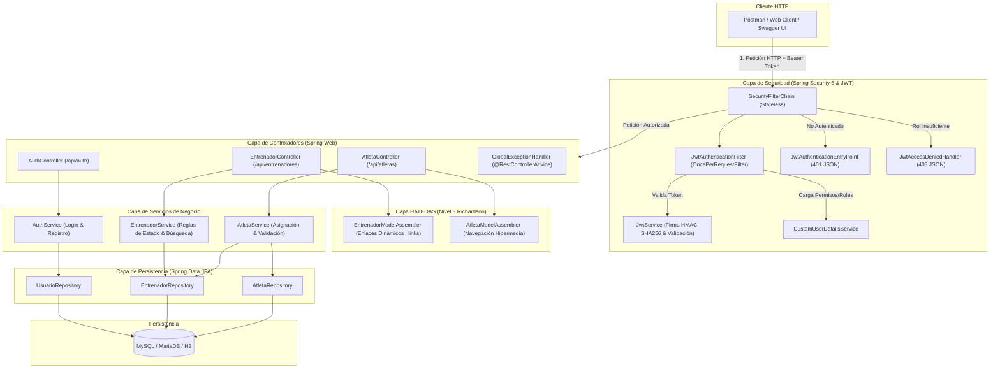

# Diagrama de Arquitectura de la Solución

La aplicación está diseñada bajo el patrón de **Arquitectura en Capas Limpia (Layered Architecture)**, separando de manera estricta las responsabilidades de presentación (REST / HATEOAS), lógica de negocio (Servicios), acceso a datos (Spring Data JPA) y la capa transversal de seguridad (Spring Security & JWT).

---

## 1. Diagrama de Componentes y Flujo de Peticiones

---

## 2. Descripción de Capas

### 2.1 Capa de Seguridad Transversal
- **`SecurityConfig`:** Configura una política de sesión sin estado (`SessionCreationPolicy.STATELESS`), deshabilita CSRF (adecuado para APIs REST basados en tokens) y restringe endpoints por rol.
- **`JwtAuthenticationFilter`:** Intercepta cada solicitud entrante, extrae el token del encabezado `Authorization: Bearer <token>`, valida la firma criptográfica y establece el contexto de seguridad (`SecurityContextHolder`).
- **`JwtAuthenticationEntryPoint` y `JwtAccessDeniedHandler`:** Garantizan que cualquier falla de autenticación devuelva un código HTTP estándar `401 Unauthorized` en formato JSON estructurado, y que un usuario con privilegios insuficientes reciba un código `403 Forbidden`.

### 2.2 Capa de Presentación y Controladores
- **`AuthController`:** Expone los endpoints públicos `/api/auth/login` y `/api/auth/registro`.
- **`EntrenadorController`:** Implementa los métodos CRUD y búsquedas, devolviendo modelos `CollectionModel` y `RepresentationModel` con hiperenlaces.
- **`AtletaController`:** Permite descubrir y gestionar los atletas asociados a un entrenador mediante enlaces hipermedia.
- **`GlobalExceptionHandler`:** Captura excepciones de validación (`MethodArgumentNotValidException`), errores 404 (`ResourceNotFoundException`) y errores 400 (`BadRequestException`), unificando las respuestas de error en un DTO estándar `ErrorResponse`.

### 2.3 Capa de Ensambladores HATEOAS (Nivel 3 de Richardson)
- **`EntrenadorModelAssembler`:** Transforma entidades JPA `Entrenador` a DTOs `EntrenadorResponse` enriquecidos con enlaces HATEOAS (`_links`). Los enlaces son dinámicos:
  - Si el entrenador está `ACTIVO`, ofrece enlaces para `desactivar` y `asignar-atleta`.
  - Si el entrenador está `INACTIVO`, ofrece el enlace para `activar`.
- **`AtletaModelAssembler`:** Incluye enlaces hacia el recurso `entrenador` padre y navegación inversa.

### 2.4 Capa de Lógica de Negocio (Servicios)
- Contiene las validaciones de negocio (por ejemplo, evitar correos duplicados y verificar que no se asignen atletas a entrenadores inactivos).
- Gestiona las transacciones con `@Transactional`.

### 2.5 Capa de Persistencia (Spring Data JPA)
- Interfaces de repositorio que extienden `JpaRepository` con consultas personalizadas `@Query` para búsquedas dinámicas con filtros combinados.

